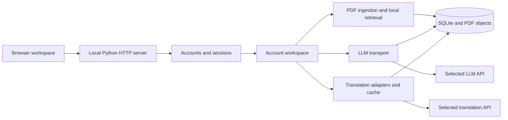

# Architecture / 架构

## Entry points / 入口

`python -m research_copilot.web` starts the browser workspace on loopback with account login. `app.py` is the legacy Streamlit interface with different account boundaries. The frontend uses native ES modules; PDF.js assets are bundled under `web/vendor/` with original license notices.

## Account routing / 账号路由

Sessions resolve a workspace directory. The first account owns the existing root workspace. Additional accounts use `data/users/<account-id>/`, marked as isolated so legacy environment credentials are not inherited. Documents, history, translations and settings use the resolved account workspace.

Passwords are salted and hashed. Sessions use HttpOnly / SameSite cookies; mutation requests include a CSRF token and are checked against allowed hosts/origins. These local controls are not a complete public hosting solution.

## Paper processing / 论文处理

Import stores the original PDF, extracts usable page text and builds local retrieval records. Answers and reading outputs refer to a document version and source locations. PDF page numbers are physical pages and may differ from printed labels.

论文问答从当前版本检索片段，再通过所选大模型生成结构化回答。来源检查用于把回答与导入材料关联，不能代替对模型推理和论文质量的人工判断。

## Two reading workflows / 两类精读

Chinese close reading translates located original paragraphs through the selected provider. Units track progress and cached translations so interrupted work can resume. The historical analysis-card workflow sends evidence to an LLM and stores structured cards. They share source references but are different outputs.

## Main modules / 主要模块

| Module under `research_copilot/` | Responsibility |
| --- | --- |
| `web.py` | HTTP routes, sessions, workspaces, frontend assets |
| `accounts.py` | Registration, login, passwords and sessions |
| `api_settings.py` | Provider presets and encrypted account settings |
| `provider_client.py`, `llm.py` | Chat Completions, Responses and Anthropic transport |
| `service.py` | Paper library and retrieval |
| `reading_provider.py` | Selected provider for Chinese reading |
| `translation_providers.py` | Translation adapter integration |
| `usage_report.py` | Combined local usage reporting |

Evaluation code and schemas are included. Private datasets, frozen paper outputs and development evidence are excluded. Optional annotation tasks return an empty state in a clean installation.

## Extending providers / 扩展接口

Add registry metadata and an adapter, then test request serialization, authentication, parsing, failures, usage accounting, cache separation and account isolation. Use synthetic fixtures; CI must not need real keys or paid requests. Preserve source references when extending reading or Q&A.
